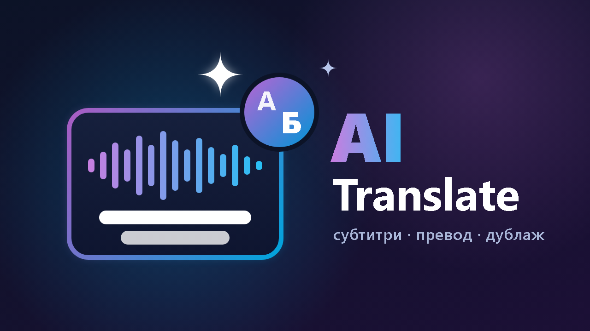

# AI Translate for Jellyfin



Subtitles for films that have none: Jellyfin extracts the audio, a speech-recognition model writes down
what is said (with timings), and an LLM translates it into your language, as a film subtitler would.

It plugs into Jellyfin's normal **subtitle search**: open a film → **⋮ → Edit subtitles → Search**, and
next to the usual results you get entries like

```
AI · OpenAI whisper-1 + OpenAI gpt-6.1-sol · ≈ $1.05
AI · Google Gemini gemini-3.5-transcribe + Google Gemini gemini-3.8-flash · ≈ $0.68
✓ Готови · openai + gemini · 16.10.2026 22:14          ← already generated, free
```

Nothing is charged until you pick one. Automatic subtitle downloads (library scans) **never** start a paid
job — they only get results that already exist.

## Two ways to get subtitles

**1. Translate an existing subtitle (fast, cheap — preferred).** If the film has a text subtitle in another
language — embedded (MKV/MP4), an external `.srt/.ass/.vtt`, or a result of another Jellyfin subtitle provider
(OpenSubtitles, Subbuzz, …) — its lines are translated with their original timings. Measured: 2250 lines in
88 s for $0.19 (Gemini 3.8 Flash). Hearing-impaired notes (`[music]`, `(sighs)`, `JOHN:`) are removed first,
dialogue keeps one speaker per line. Image subtitles (DVD/Blu-ray) are not used.

**2. Generate from the audio track (slow).** Only offered when no text subtitle exists (configurable).
Measured on a 98-minute film: $0.74 and ~20 minutes with Gemini on Tier 1 rate limits.

By default AI options appear only when the film has no subtitles in that language and the other providers
found none. Finished AI subtitles are always listed (free).

## How the audio path works

1. **Audio**: Jellyfin's ffmpeg extracts the default audio track as mono 16 kHz MP3 chunks (any container
   Jellyfin plays: MKV, MP4, AVI, TS, M2TS, …).
2. **Speech → text with timings**
   - OpenAI `whisper-1` (segment timestamps), or
   - Google `gemini-3.5-transcribe` (word timestamps).
   The transcript is cached: a second translator or another language only pays for the translation.
3. **Translation** in batches of 50 lines with the preceding lines as context, structured JSON output,
   validated line by line (no merged or dropped lines), retried on temporary errors. The film can be in any language;
   if it is already in the target language, translation is skipped.
4. **Subtitles**: lines are wrapped to ≤ 2 × 42 characters and handed to Jellyfin, which saves them next to
   the film (or in its metadata folder) like any downloaded subtitle.

If the client gives up waiting, the job keeps running and Jellyfin still saves the subtitle when it finishes.

## Costs

Measured (October 2026 list prices, editable in the settings):

| Job | Result |
|---|---|
| Translate 2250 English lines → Bulgarian, Gemini 3.8 Flash, thinking `low` | **$0.19**, 88 s |
| Same with the model's default thinking | $0.59, 274 s |
| Audio 98 min → Bulgarian, Gemini Transcribe + Gemini 3.8 Flash | **$0.74**, ~20 min (Tier 1) |

Gemini Transcribe on Tier 1 is limited to 10 000 audio tokens per minute (≈ 6.5 min of audio per minute);
the plugin sizes chunks and paces requests to that limit (configurable when your tier is higher).
Translation uses a low thinking/reasoning level by default: about a third of the billed tokens, same result.

The settings page shows this month's spend per provider/model (audio minutes, tokens) and a **monthly
limit**; a job that would exceed it is refused. The provider's invoice is what counts — the plugin's numbers
are estimates from token counts and list prices.

## Voice-over (AI dubbing)

Dashboard → Plugins → AI Translate → **Дублаж**: search a film that has subtitles in your language, press
**Цена** for the estimate, pick provider and voice, press **Озвучи**. Manual only — nothing is dubbed
automatically.

How it works:

1. **Text and timing come from the subtitles** in the target language (any source: human subtitles,
   OpenSubtitles, or ones this plugin made). The film's own audio is *not* recognised again for dubbing.
2. Song-only lines (♪ …) are skipped; short neighbouring lines are joined; ~10 lines go into one request
   with a pause marker between them, and the returned audio is cut back into lines at the pauses.
3. Each line is placed at its subtitle time; if it is too long it is sped up (up to 1.3×), otherwise the
   next line moves a little later and catches up in the next gap.
4. **TV-style voice-over**: the original soundtrack stays underneath and is turned down automatically while
   the narrator speaks (sidechain ducking).
5. The result is a separate audio file next to the film, `Film.bg.mka`, which Jellyfin shows as the audio
   track **"Български (AI войсоувър)"**. The video file is never modified.

One narrator voice for everyone (Bulgarian TV style). Separate voices per speaker would need speaker
detection from the audio; that is on the roadmap.

Measured: *The Mongoose* (98 min, 638 lines) with Gemini 3.8 Flash-Lite TTS — 64 requests, 10 minutes,
**$0.32**.

| Provider | Voices | Bulgarian | Price (list) | Limits |
|---|---|---|---|---|
| Google Gemini `gemini-3.8-flash-tts` | 30 (12 offered) | native | $9 / 1M audio tokens ≈ $0.0135/min (doubles from 2027-01-01) | **Tier 1: 10 requests/min, 100 requests/day** |
| Google Gemini `gemini-3.8-flash-lite-tts` | same | native | $6 / 1M ≈ $0.009/min | own quota, same Tier 1 limits |
| OpenAI `gpt-4o-mini-tts` | 13 | works, voices tuned for English | $12 / 1M audio tokens (≈ $0.015/min) | 2000 requests/min, 2000 input tokens per request |

## Limits and safeguards

Providers limit how much you may use per minute and per day, and every job costs money. The plugin:

| Risk | What the plugin does |
|---|---|
| Spending too much | **Monthly budget** (default $10): a job whose estimate would exceed it is refused. The estimates of running jobs are held, so several jobs started together cannot pass it either. Every request is written to a cost log (settings page, per provider and model). |
| Paying by accident | Subtitle search shows the **price before you choose**; automatic subtitle downloads (library scans) never start a paid job; dubbing is manual only. |
| Requests per minute (Gemini Transcribe: 10 000 audio tokens/min; Gemini TTS: 10 requests/min on Tier 1) | Requests are **paced** to the configured limit; a `429` with "retry in Ns" is retried after that time. |
| Requests per day (Gemini TTS: 100/day on Tier 1) | Lines are **batched ~10 per request** (a film needs ~60–70). Requests are **counted per day**; the estimate shows "today X / 100" and warns in red when a film needs more than is left. Start is refused when nothing is left. A daily-quota `429` stops the job at once (no pointless retries) with a message saying when the quota resets (00:00 UTC). |
| Losing work when a limit hits | Every recognised audio chunk, translated batch and spoken line is **cached on disk** as soon as it is done. Running the same job again continues where it stopped and does not pay again for what is done; what was paid is in the cost log even when a job stops. |
| A broken key, an empty balance, an outage | The job **stops with the provider's message** (rate limits and server errors 500/502/503/504 are retried first). Untranslated lines are never saved as a translation. A failed job leaves a one-line note in the subtitle, and picking the subtitle again retries it. |
| Client gives up waiting (subtitles) | The job keeps running; Jellyfin still saves the subtitle when it finishes. |
| A job you no longer want | **Спри** next to every running job on the settings page (subtitles and voice-overs). What is finished stays cached; picking it again continues from there. |
| Disk space | Finished subtitles and transcripts stay while the film is in the library. Spoken lines of voice-overs (~100 MB per film) are deleted when unused for 30 days or over 2 GB, least recently used first; unfinished jobs after 14 days. A daily task (04:00) does it; the settings page shows the space per kind with **Изчисти** buttons. |

Limits differ per account tier and change over time; set yours in **Models and prices** (requests per
minute/day, tokens per minute, prices). Google shows your actual limits in AI Studio → Rate limits.

## Install

1. Dashboard → Plugins → Repositories → add
   `https://raw.githubusercontent.com/HA-HUB-I/jellyfin-plugin-ai-translate/main/manifest.json`
2. Catalog → **AI Translate** → Install → restart Jellyfin.
3. Dashboard → Plugins → AI Translate: paste an **OpenAI** and/or **Google Gemini** API key, choose the
   subtitle languages (e.g. `bg`), set a monthly limit.
4. Enable the provider for your libraries: Library → Manage library → *Subtitle downloaders* → **AI Translate**.

Requires Jellyfin 12.2+.

## Privacy

The film's audio is uploaded to the provider you pick (OpenAI or Google) for recognition; subtitle text is
sent for translation. Gemini files are deleted right after use. API keys are stored in Jellyfin's plugin
configuration on your server.

## Roadmap

- Google Cloud Text-to-Speech (`bg-BG` Chirp3-HD, 30 Bulgarian voices, much higher quotas).
- Separate voices per speaker (speaker detection + male/female voice).
- More providers (Deepgram, ElevenLabs, Anthropic, DeepL).

## Български

Добавка за Jellyfin, която генерира субтитри за филми без такива: разпознава говора от аудиото (OpenAI или
Google Gemini) и превежда с езиков модел на български (или друг език). Появява се в търсенето на субтитри
на Jellyfin с прогнозна цена за всеки вариант; таксува се само при избор. Има месечен лимит и дневник на
разходите в настройките.

**Дублаж (войсоувър):** озвучава ръчно избран филм от българските му субтитри — един диктор, оригиналният
звук остава отдолу, като по телевизията. Резултатът е отделна аудиопътечка „Български (AI войсоувър)“;
видеото не се пипа. Лимитите на доставчиците (заявки в минута/ден) се спазват автоматично, оценката
предупреждава, ако филмът не се побира в днешния лимит, а прекъсната работа продължава безплатно оттам,
докъдето е стигнала.

## License

GPL-3.0, like Jellyfin.
